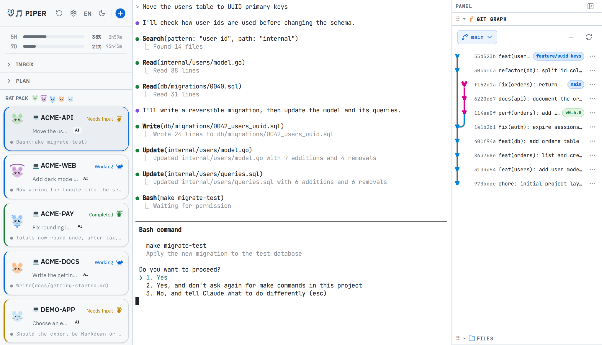

# piper

A web dashboard for running several [Claude Code](https://docs.anthropic.com/en/docs/claude-code) sessions at once. [繁體中文](docs/README.zh-TW.md)

Once you have three or four Claude Code sessions going, most of your attention goes to checking on them: which one is still working, which one has finished, and which one has been sitting on a permission prompt while you looked elsewhere. piper runs each session in its own tmux session and shows them all on one page. Every card says whether that session is working, finished or waiting for you, and clicking a card opens its terminal right there in the browser.

<picture>
  <source media="(prefers-color-scheme: dark)" srcset="docs/images/dashboard-dark.png">
  
</picture>

<sub>Example sessions in made-up projects.</sub>

## Get started

```bash
go install github.com/miskawu/piper@latest
piper
# then open http://localhost:8622
```

You need Go 1.26+, [tmux](https://github.com/tmux/tmux), Claude Code, and Node.js for the status hooks. `go install` puts `piper` in `$(go env GOPATH)/bin`, so that directory has to be on your `PATH`. The UI is pre-built and embedded in the binary.

In the browser, press **+** at the top of the sidebar and choose a working directory. piper starts `claude` there in a new tmux session and adds a card for it. By default piper only listens on `127.0.0.1`; see [Security](#security).

## What you get

- **A card for each session.** It shows the project, a one-line summary of the task, the last line of output, and one of three states: *Working*, *Completed* or *Needs Input*. Claude Code's hooks report these states, so a card changes when the session does.
- **The session's terminal in the browser.** Clicking a card attaches to its tmux session through xterm.js. You can type, answer prompts, paste images and drop files; piper uploads the file and types its path at the prompt.
- **Sessions that outlive the page.** They run in tmux, so closing the tab or restarting piper leaves them running. If tmux itself goes away, for example after a reboot, *Recent Sessions* can reopen them, and resumes the Claude conversation when its history is still on disk.
- **Git and files beside the terminal.** A side panel shows the commit graph and a file tree for the session's project.
- **Your usage limits.** Once a session has reported them, the sidebar shows how much of your 5-hour and 7-day limits you have used. Click it for monthly charts of usage and work time.

The interface comes in English and Traditional Chinese, with dark and light themes. It calls sessions "ragents" and gives each one a mouse avatar generated from its name.

### Also included

- **Inbox.** Press Ctrl+I to jot down an idea, let Claude expand it, and turn it into a new session.
- **Epic planning.** Break larger work into a story map, dispatch task briefs to your projects, and review the finished work in a retro. See [`internal/plan/`](internal/plan/README.md).
- **DevContainers.** Run a session inside a project's DevContainer instead of on the host. piper stops the container after the last session for that project ends. This needs Docker and the devcontainer CLI.
- **Daily digest.** A summary of yesterday's work, sent to a Discord webhook if you set one in Settings.

## What piper does on your machine

- **It overwrites `.claude/settings.local.json`** in the working directory of each new local session, to install its status hooks and status line. If you keep your own settings in that file, they are replaced.
- **It runs `claude -p` in the background**, which counts against your Claude usage: for the summaries on the cards (Haiku by default), and for inbox ideas and digests when you use those. A description you type yourself is left alone and stops the automatic summary for that session.
- **It only lists tmux sessions whose name contains `ragent`**, so your other tmux sessions stay out of the dashboard. At startup it closes its own leftover `pplan-` and `psetup-` sessions.
- **It keeps its data in `~/.local/share/piper/`**, or `$XDG_DATA_HOME/piper/` if that is set.

## Security

Piper can open a shell, so every request passes through [`internal/guard`](internal/guard/guard.go):

- It binds to `127.0.0.1` by default, and `make run` keeps it there.
- `Host` and `Origin` must be an address Piper itself is bound to. Cross-origin WebSocket handshakes and API calls get a 403, so a web page cannot reach `ws://127.0.0.1:8622/ws/host-shell`.
- Binding to a non-loopback address (`make run-lan`, or `-host` with a LAN IP) generates a token at startup, printed once in the terminal. Open the printed URL and the browser keeps the token in an HttpOnly cookie; anything else gets a 401. API clients send `Authorization: Bearer <token>`, and DevContainers receive it as `PIPER_TOKEN`.

## Prerequisites

| Tool | Required | Purpose |
|------|----------|---------|
| [tmux](https://github.com/tmux/tmux) | Yes | Core session management |
| [Claude Code](https://docs.anthropic.com/en/docs/claude-code) | Yes | Claude CLI |
| [Node.js](https://nodejs.org/) | For live status | Runs the hooks that report session state. Without it, sessions stay at *Needs Input* |
| git | Optional | Epic Git sync, git graph |
| docker | Optional | DevContainer features, epic container sessions |
| [devcontainer CLI](https://github.com/devcontainers/cli) | Optional | DevContainer create/rebuild |
| bubblewrap | Optional (Linux) | Sandbox |
| socat | Optional (Linux) | Sandbox network isolation |

On startup, piper checks for tmux, Claude Code, git, docker, bubblewrap and socat. A missing required tool stops startup, and a missing optional tool shows a warning. Node.js is not part of that check.

## Build from source

Requires Go 1.26+ and Node.js 22+.

```bash
git clone https://github.com/miskawu/piper.git
cd piper
make build    # build UI + Go → single binary
./piper
```

## CLI Flags

| Flag | Default | Description |
|------|---------|-------------|
| `-host` | `127.0.0.1` | Bind addresses, comma-separated (e.g. `127.0.0.1,192.168.1.10`). A non-loopback address requires the token printed at startup |
| `-allow-origin` | | Extra trusted origins, comma-separated (e.g. `http://localhost:5173` for the Vite dev server) |
| `-port` | `8622` | HTTP server port |
| `-poll` | `2s` | Session poll interval |
| `-version` | | Print version and exit |
| `-project-root` | `.` | Accepted, but nothing reads it at the moment |

## Architecture

Single binary: Go backend serves a React UI via `go:embed`.

```
┌─────────────────────────────────────────────────────┐
│                    Go Backend                        │
│                                                     │
│  ┌─────────────┐  ┌──────────┐  ┌───────────────┐  │
│  │Session Core │  │  Epic    │  │ DevContainer  │  │
│  │tmux watcher │  │  Planning│  │ Management    │  │
│  │ws pty store │  │plan vault│  │ devcontainer  │  │
│  │  lockfile   │  │dispatch  │  │ epiccontainer │  │
│  │             │  │retro     │  │ autostop      │  │
│  │             │  │          │  │ preflight     │  │
│  └─────────────┘  └──────────┘  └───────────────┘  │
│                                                     │
│  ┌─────────────┐  ┌──────────────────────────────┐  │
│  │ AI & Usage  │  │ UI Utilities                 │  │
│  │ summarizer  │  │ browse clipboard git         │  │
│  │ usage digest│  │ gitwatcher mousedex          │  │
│  │ claude      │  │                              │  │
│  └─────────────┘  └──────────────────────────────┘  │
└─────────────────────────────────────────────────────┘
         │
         │ go:embed
         ▼
┌─────────────────────┐
│   React UI          │
│ xterm.js React Query│
│ i18next  WebSocket  │
└─────────────────────┘
```

### Module Documentation

Each domain has its own README with data flows, key interfaces, and related APIs:

| Domain | README | Packages |
|--------|--------|----------|
| **Session Core** | [`internal/tmux/`](internal/tmux/README.md) | tmux, watcher, ws, pty, store, lockfile |
| **Epic Planning** | [`internal/plan/`](internal/plan/README.md) | plan, vault, dispatch, retro, epiccontainer |
| **DevContainer** | [`internal/devcontainer/`](internal/devcontainer/README.md) | devcontainer, autostop, preflight |
| **AI & Usage** | [`internal/summarizer/`](internal/summarizer/README.md) | summarizer, usage, digest, claude |
| **UI Utilities** | [`internal/browse/`](internal/browse/README.md) | browse, clipboard, git, gitwatcher, mousedex |

### Status Detection

A session's state comes from Claude Code hooks, which post lifecycle events to `/api/internal/hook-status`:

| State | When |
|-------|------|
| **working** | `UserPromptSubmit`, `PreToolUse` or `SubagentStart` fired |
| **completed** | `Stop` or an `idle_prompt` notification arrived while the session was working. It stays completed until you open the session's terminal |
| **needs_input** | A permission prompt or `StopFailure`, a completed session you have already opened, or a session that has not reported anything yet |

piper still reads the bottom 50 lines of the tmux pane, but only to show the last line of output on the card.

## Development

```bash
make dev-ui          # Vite dev server with HMR
make dev-backend     # Go with hot reload (air)
go test ./...        # Run all tests
```

## License

[Apache License 2.0](LICENSE)
