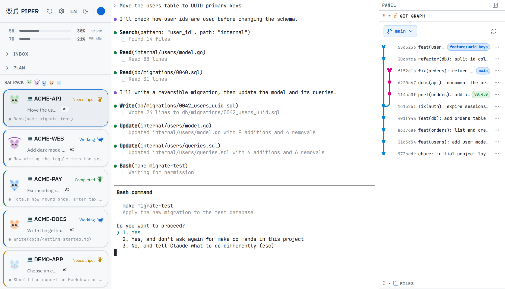

# piper

同時開多個 [Claude Code](https://docs.anthropic.com/en/docs/claude-code) session 時用的網頁儀表板。[English](../README.md)

同時開三、四個 Claude Code session 之後，注意力大多花在巡視：哪個還在跑、哪個做完了、哪個卡在權限確認而你剛好沒看到。piper 把每個 session 放在各自的 tmux session 裡，全部列在同一頁。每張卡片都標出該 session 是執行中、已完成還是在等你，點一下卡片，就能直接在瀏覽器裡操作它的終端機。

<picture>
  <source media="(prefers-color-scheme: dark)" srcset="images/dashboard-dark.png">
  
</picture>

<sub>畫面中是虛構專案的示例 session。</sub>

## 快速開始

```bash
go install github.com/miskawu/piper@latest
piper
# 然後打開 http://localhost:8622
```

需要 Go 1.26+、[tmux](https://github.com/tmux/tmux)、Claude Code，以及執行狀態 hook 用的 Node.js。`go install` 會把 `piper` 放到 `$(go env GOPATH)/bin`，這個目錄要在 `PATH` 裡。前端已預先建置並嵌入 binary。

進到網頁後，按側邊欄上方的 **+**，選一個工作目錄，piper 就會在新的 tmux session 裡啟動 `claude`，並加上一張卡片。piper 預設只聽 `127.0.0.1`，詳見[安全](#安全)。

## 用起來是什麼樣子

- **每個 session 一張卡片。** 卡片上有專案名、一句話的任務摘要、最後一行輸出，以及三種狀態之一：*執行中*、*已完成*、*等待輸入*。狀態由 Claude Code 的 hook 回報，session 一變，卡片跟著變。
- **在瀏覽器裡操作 session 的終端機。** 點卡片會透過 xterm.js 連上該 tmux session。可以打字、回答提示、貼上圖片、拖放檔案；piper 會上傳檔案，再把路徑打到輸入列上。
- **關掉網頁，session 還在。** session 跑在 tmux 裡，關分頁或重啟 piper 都不影響。如果 tmux 本身沒了（例如重開機），可以從*最近的工作階段*重新開啟；對話紀錄還在磁碟上的話，會接續原本的 Claude 對話。
- **終端機旁邊就有 Git 和檔案。** 側邊面板顯示該 session 專案的 commit 線圖與檔案樹。
- **看得到用量上限。** 只要有 session 回報過，側邊欄就會顯示 5 小時與 7 天額度用了多少。點一下可以看每月的用量與工作時間圖表。

介面有英文與繁體中文，也有深淺兩種主題。介面把 session 叫做「Ragent」，並依名稱替每個 session 產生一隻老鼠頭像。

### 其他功能

- **隨手記。** 按 Ctrl+I 記下想法，可以請 Claude 充實內容，再轉成新的 session。
- **Epic 規劃。** 把較大的工作拆成 story map，派送 task brief 到各專案，完成後做回顧。詳見 [`internal/plan/`](../internal/plan/README.md)。
- **DevContainer。** 讓 session 跑在專案的 DevContainer 裡，而不是直接在主機上。該專案最後一個 session 結束後，piper 會把容器停掉。需要 Docker 與 devcontainer CLI。
- **每日摘要。** 彙整昨天的工作，在設定裡填好 Discord webhook 就會發送。

## piper 會在你的機器上做什麼

- **把狀態 hook 與 status line 加進 `.claude/settings.local.json`。** 每開一個新的本機 session，piper 都會在它的工作目錄這樣做，你的權限、其他設定和自己的 hook 都會留著。如果檔案裡已經有你自己的 status line，piper 不會動它，儀表板也就拿不到該 session 的用量與 context 數字。檔案不是合法 JSON 時，piper 完全不碰它，該 session 沒有狀態 hook。DevContainer session 目前仍會整份取代專案裡的這個檔案。
- **在背景執行 `claude -p`，這會計入你的 Claude 用量。** 用途是卡片上的摘要（預設 Haiku），以及你使用隨手記和每日摘要的時候。你自己輸入的描述不會被改動，該 session 也不再自動摘要。
- **只列出名稱含 `ragent` 的 tmux session**，你其他的 tmux session 不會出現在儀表板上。啟動時它會關掉自己遺留的 `pplan-`、`psetup-` session。
- **資料放在 `~/.local/share/piper/`**；有設 `XDG_DATA_HOME` 的話放在 `$XDG_DATA_HOME/piper/`。

## 安全

Piper 能開 shell，所以每個請求都先經過 [`internal/guard`](../internal/guard/guard.go)：

- 預設只綁 `127.0.0.1`，`make run` 也一樣。
- `Host` 與 `Origin` 必須是 Piper 自己綁定的位址。跨來源的 WebSocket 連線與 API 呼叫都回 403，所以網頁連不到 `ws://127.0.0.1:8622/ws/host-shell`。
- 綁到非 loopback 位址（`make run-lan`，或 `-host` 帶內網 IP）時，啟動會產生 token，只在終端機印一次。打開印出的網址後，瀏覽器把 token 存在 HttpOnly cookie；其他連線一律回 401。API 用戶端帶 `Authorization: Bearer <token>`，DevContainer 會收到 `PIPER_TOKEN` 環境變數。

## 系統需求

| 工具 | 級別 | 用途 |
|------|------|------|
| [tmux](https://github.com/tmux/tmux) | 必要 | 核心 session 管理 |
| [Claude Code](https://docs.anthropic.com/en/docs/claude-code) | 必要 | Claude CLI |
| [Node.js](https://nodejs.org/) | 要看即時狀態時需要 | 執行回報 session 狀態的 hook。沒有的話，session 會一直顯示*等待輸入* |
| git | 可選 | Epic Git 同步、Git 線圖 |
| docker | 可選 | DevContainer 功能、Epic 容器 session |
| [devcontainer CLI](https://github.com/devcontainers/cli) | 可選 | DevContainer 建立/重建 |
| bubblewrap | 可選（Linux） | Sandbox |
| socat | 可選（Linux） | Sandbox 網路隔離 |

啟動時 piper 會檢查 tmux、Claude Code、git、docker、bubblewrap 和 socat。必要工具缺少會阻擋啟動，可選工具缺少只顯示警告。Node.js 不在檢查之列。

## 從原始碼建置

需要 Go 1.26+ 和 Node.js 22+。

```bash
git clone https://github.com/miskawu/piper.git
cd piper
make build    # 先 build UI 再 build Go → 單一 binary
./piper
```

## CLI 參數

| Flag | 預設值 | 說明 |
|------|--------|------|
| `-host` | `127.0.0.1` | 綁定位址，逗號分隔（例：`127.0.0.1,192.168.1.10`）。非 loopback 位址要帶啟動時印出的 token |
| `-allow-origin` | | 額外信任的來源，逗號分隔（例：Vite 開發伺服器的 `http://localhost:5173`） |
| `-port` | `8622` | HTTP server port |
| `-poll` | `2s` | Session 狀態輪詢間隔 |
| `-version` | | 顯示版本並退出 |
| `-project-root` | `.` | 可以傳入，但目前沒有任何地方使用 |

## 架構

單一 binary：Go 後端透過 `go:embed` 提供 React UI。

```
┌─────────────────────────────────────────────────────┐
│                    Go 後端                           │
│                                                     │
│  ┌─────────────┐  ┌──────────┐  ┌───────────────┐  │
│  │Session 核心 │  │ Epic     │  │ DevContainer  │  │
│  │tmux watcher │  │ 規劃     │  │ 管理          │  │
│  │ws pty store │  │plan vault│  │ devcontainer  │  │
│  │  lockfile   │  │dispatch  │  │ epiccontainer │  │
│  │             │  │retro     │  │ autostop      │  │
│  │             │  │          │  │ preflight     │  │
│  └─────────────┘  └──────────┘  └───────────────┘  │
│                                                     │
│  ┌─────────────┐  ┌──────────────────────────────┐  │
│  │ AI & 用量   │  │ UI 輔助                      │  │
│  │ summarizer  │  │ browse clipboard git         │  │
│  │ usage digest│  │ gitwatcher mousedex          │  │
│  │ claude      │  │                              │  │
│  └─────────────┘  └──────────────────────────────┘  │
└─────────────────────────────────────────────────────┘
         │
         │ go:embed
         ▼
┌─────────────────────┐
│   React UI          │
│ xterm.js React Query│
│ i18next  WebSocket  │
└─────────────────────┘
```

### 模組文件

每個功能域都有獨立 README，包含資料流、關鍵介面、相關 API：

| 功能域 | README | 包含的 packages |
|--------|--------|----------------|
| **Session 核心** | [`internal/tmux/`](../internal/tmux/README.md) | tmux, watcher, ws, pty, store, lockfile |
| **Epic 規劃** | [`internal/plan/`](../internal/plan/README.md) | plan, vault, dispatch, retro, epiccontainer |
| **DevContainer** | [`internal/devcontainer/`](../internal/devcontainer/README.md) | devcontainer, autostop, preflight |
| **AI & 用量** | [`internal/summarizer/`](../internal/summarizer/README.md) | summarizer, usage, digest, claude |
| **UI 輔助** | [`internal/browse/`](../internal/browse/README.md) | browse, clipboard, git, gitwatcher, mousedex |

### 狀態偵測

session 的狀態來自 Claude Code hook，由 hook 把生命週期事件送到 `/api/internal/hook-status`：

| 狀態 | 條件 |
|------|------|
| **working** | 觸發 `UserPromptSubmit`、`PreToolUse` 或 `SubagentStart` |
| **completed** | session 執行中收到 `Stop` 或 `idle_prompt` 通知。會一直維持，直到你打開該 session 的終端機 |
| **needs_input** | 權限確認或 `StopFailure`、已經打開看過的 completed session，或還沒回報過任何事件的 session |

piper 仍會讀取 tmux pane 底部 50 行，但只用來在卡片上顯示最後一行輸出。

## 開發

```bash
make dev-ui          # Vite dev server + HMR
make dev-backend     # Go + Air hot-reload
go test ./...        # 執行所有測試
```

## 授權

[Apache License 2.0](../LICENSE)
